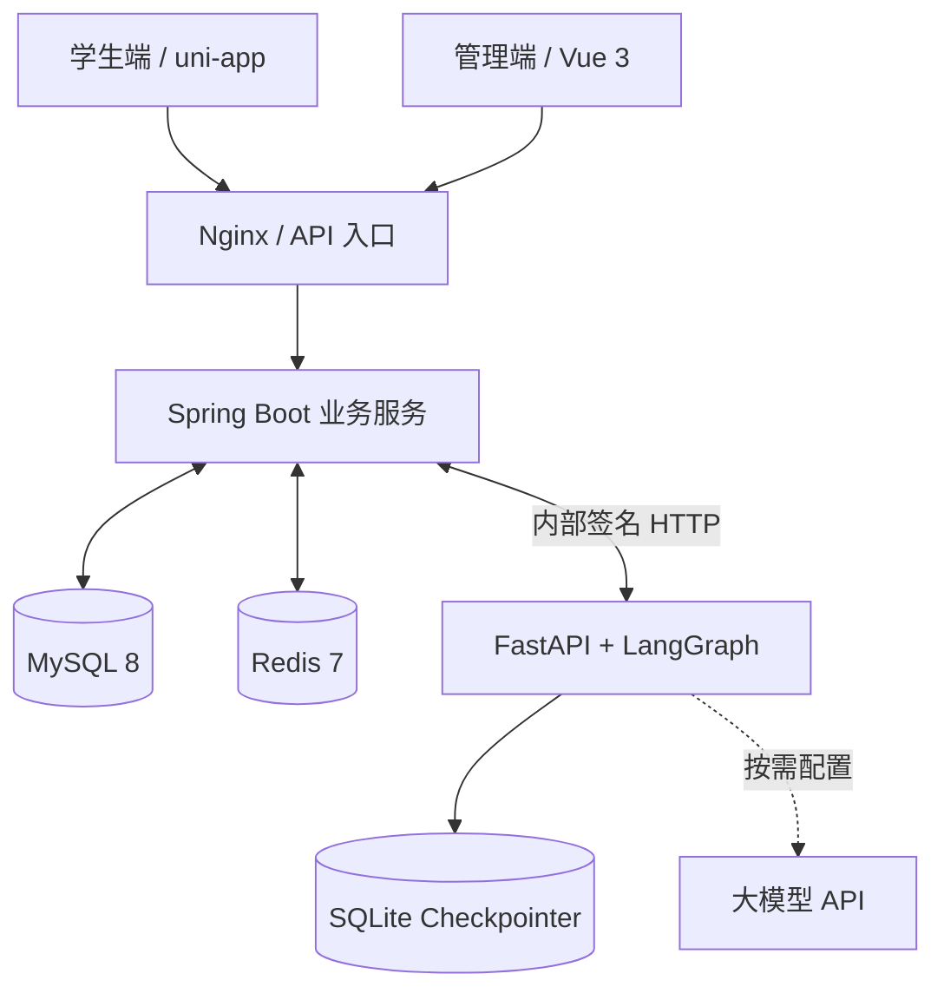

# 顺手 ShunShou

> 基于 **Spring Boot + Vue 3 + uni-app + Python Agent** 的校园 C2C 互助交易平台。
>
> 让学生既能发布跑腿任务，也能承接同校区需求，并通过 AI 辅助完成委托和顺路任务匹配。


> [!IMPORTANT]
> **本项目目前主要用于学习、开发和演示。** 钱包、支付、退款和结算均为**模拟资金流程**，不接入真实收付款。真实大模型效果、校园路线数据与移动端真机体验仍需进一步验证。

## 目录

- [项目简介](#项目简介)
- [核心功能](#核心功能)
- [技术栈](#技术栈)
- [系统架构](#系统架构)
- [目录结构](#目录结构)
- [快速开始](#快速开始)
- [本地开发](#本地开发)
- [数据库与持久化](#数据库与持久化)
- [已知限制](#已知限制)
- [开源许可与致谢](#开源许可与致谢)

## 项目简介

**顺手（ShunShou）** 面向校园内的代取快递、买饭、打印等互助场景。完成校区认证的学生可以使用**同一个账号发单和接单**，平台围绕任务、订单、服务和交流提供完整的业务操作。

系统采用前后端分离与独立 AI 服务的设计：

- **学生端**：uni-app，面向任务发布、接单、订单管理、即时交流和智能助手。
- **管理端**：Vue 3，面向校区、用户、任务、订单、售后及运营管理。
- **业务后端**：Spring Boot，负责认证、权限、状态流转、模拟交易与数据一致性。
- **AI Agent**：FastAPI + LangGraph，负责自然语言需求理解、服务撮合、顺路推荐及人工确认工作流。

## 核心功能

| 模块 | 功能 |
| --- | --- |
| 账户与校园认证 | 注册登录、JWT 鉴权、学生认证、校区管理与同校区数据隔离 |
| 校园任务 | 发布任务、搜索筛选、接单、取货、送达、确认、取消和超时处理 |
| 服务橱窗 | 发布个人服务、查询服务、选择指定服务者预约 |
| 实时交流 | WebSocket/STOMP 私信、通知推送、跑腿员信息及评价 |
| 模拟交易 | 预付、钱包、交易流水、结算、退款和售后争议处理 |
| 运营后台 | 学校/校区、用户、订单、争议管理及运营统计、模拟资金核对 |
| 智能委托 | Agent 多轮补齐需求，查询同校区服务，生成任务或预约草稿 |
| 顺路任务推荐 | 按位置、时间、任务条件和绕路上限筛选候选；无法核实路线时提示不确定性 |

### 技术亮点

- **高并发接单**：Redisson 分布式锁结合 MySQL 事务与条件更新（CAS），防止多个请求重复接取同一任务。
- **Redis 缓存优化**：通过 Spring Cache 缓存热点数据，结合空值缓存、互斥锁与双重检查缓解缓存穿透、击穿。
- **实时通信与权限**：基于 WebSocket + STOMP 推送私信和通知，并校验用户身份与校区边界。
- **可控 Agent**：基于 LangGraph 进行多轮状态管理、结构化信息提取与 Human-in-the-Loop 确认；交易写操作始终由 Java 业务服务执行。
- **容器化部署**：使用多阶段 Dockerfile 构建前后端，通过 Docker Compose 统一编排应用、数据库、缓存和代理服务。

## 技术栈

| 层次 | 技术 |
| --- | --- |
| Java 后端 | Java 21、Spring Boot 3.2、Spring MVC、Spring AOP、MyBatis-Plus |
| 数据库与缓存 | MySQL 8、Redis 7、Spring Data Redis、Spring Cache、Redisson |
| 安全与通信 | JWT、HMAC 内部签名、WebSocket、STOMP、SockJS |
| 管理端 | Vue 3、TypeScript、Vite、Element Plus、Pinia、ECharts |
| 学生端 | uni-app、Vue |
| AI 服务 | Python 3.13、FastAPI、LangGraph、LangChain OpenAI、Pydantic、HTTPX |
| Agent 状态 | SQLite Checkpointer（当前为单实例方案） |
| 构建与部署 | Maven、Node.js、Docker、Docker Compose、Nginx |

目前**未接入 RabbitMQ、RocketMQ 或 Kafka**；实时聊天使用 Spring 内置的 STOMP SimpleBroker，不等同于独立消息队列。

## 系统架构



**职责边界**：Python Agent 负责理解意图、查询和生成建议，**不直接写交易数据库**。任务发布、服务预约、抢单及模拟资金操作由 Spring Boot 完成最终校验；关键操作需要用户明确确认。

## 目录结构

```text
INPassing/
├── backend/                 # Spring Boot 多模块后端与数据库脚本
│   ├── runningerrands-common/
│   ├── runningerrands-model/
│   ├── runningerrands-server/
│   ├── migrations/
│   └── runningerrands.sql
├── admin/                   # Vue 3 + TypeScript 管理后台
├── mobile/                  # uni-app 学生端（包含智能助手页面）
├── ai-service/              # FastAPI + LangGraph Agent
├── docker/                  # Compose、Nginx、环境变量模板
├── Dockerfile               # Vue + Java 多阶段构建
├── LICENSE
└── README.md
```

## 快速开始

推荐使用 **Docker Compose** 启动后端、管理端、MySQL、Redis、Python Agent 和 Nginx。uni-app 学生端需要单独使用 HBuilderX 构建与调试。

### 1. 环境要求

- Git
- Docker Desktop（Windows 推荐 WSL2 / Linux 容器模式）或 Docker Engine
- Docker Compose v2

### 2. 获取代码

```bash
git clone https://github.com/Miao-wang11/INPassing.git
cd INPassing
```

### 3. 配置环境变量

将示例配置复制为 `docker/.env`。

**Linux / macOS**

```bash
cp docker/.env.example docker/.env
```

**Windows PowerShell**

```powershell
Copy-Item docker\.env.example docker\.env
```

编辑 `docker/.env`，至少设置：

```dotenv
MYSQL_ROOT_PASSWORD=替换为强数据库密码
JWT_ADMIN_SECRET=替换为随机管理员JWT密钥
JWT_USER_SECRET=替换为不同的随机学生JWT密钥
ADMIN_USERNAME=admin
ADMIN_PASSWORD=替换为强管理员密码
SHUNSHOU_AI_INTERNAL_TOKEN=替换为至少32字节随机密钥

# 本地演示：有限规则解析，不是真实大模型
SHUNSHOU_AI_ENVIRONMENT=development
SHUNSHOU_AI_MODEL_PROVIDER=mock
```

可以用 `python -c "import secrets; print(secrets.token_hex(32))"` 生成随机服务间密钥。

需要验证真实大模型时，将提供兼容接口的模型配置填入：

```dotenv
SHUNSHOU_AI_MODEL_PROVIDER=openai_compatible
SHUNSHOU_AI_MODEL_NAME=你的模型名称
SHUNSHOU_AI_MODEL_BASE_URL=模型API地址
SHUNSHOU_AI_MODEL_API_KEY=模型API密钥
```

腾讯地图、阿里云 OSS/短信和微信相关 Key 按需填写。**仅配置 `TENCENT_MAP_API_KEY` 不会自动生成 Agent 顺路推荐所需的经核实校园步行路网。**

> [!CAUTION]
> 请勿将 `docker/.env`、真实 API Key、用户数据或账号密码提交到 GitHub。请勿在公网环境直接使用开发默认配置。

### 4. 一键启动

在**仓库根目录**执行：

```bash
docker compose --env-file docker/.env -f docker/docker-compose.yml config
docker compose --env-file docker/.env -f docker/docker-compose.yml up --build -d
docker compose --env-file docker/.env -f docker/docker-compose.yml ps
```

Compose 创建或启动五个服务：`mysql`、`redis`、`backend`、`ai-service` 和 `nginx`。首次构建会安装依赖并编译 Vue、Java 和 Python 应用。

### 5. 访问地址

| 服务 | 默认地址 |
| --- | --- |
| Vue 管理后台 | <http://localhost/api/> |
| Spring Boot 健康检查 | <http://localhost:8080/api/actuator/health> |
| MySQL | `127.0.0.1:3308`（数据库 `runningerrands`） |
| Redis | `127.0.0.1:6381`（逻辑库 `1`） |

宿主机端口可通过 `docker/.env` 的 `NGINX_PORT`、`BACKEND_PORT`、`MYSQL_PORT`、`REDIS_PORT` 调整。

Python Agent 在 Docker 内部监听 8000 端口，**不向宿主机直接发布端口**；学生端通过 Java 鉴权接口使用 Agent。

### 6. 常用命令

```bash
# 查看服务状态
docker compose --env-file docker/.env -f docker/docker-compose.yml ps

# 查看 Java / Python 日志
docker compose --env-file docker/.env -f docker/docker-compose.yml logs -f backend
docker compose --env-file docker/.env -f docker/docker-compose.yml logs -f ai-service

# 重新构建并启动
docker compose --env-file docker/.env -f docker/docker-compose.yml up --build -d

# 停止并删除容器（保留数据卷）
docker compose --env-file docker/.env -f docker/docker-compose.yml down
```

**不要在有业务数据时随意执行 `docker compose down -v`**，否则会删除 Compose 管理的数据卷。

## 本地开发

### Spring Boot

使用 **JDK 21**，通过 IDEA 打开 `backend/pom.xml`。参考 `backend/runningerrands-server/src/main/resources/application-template.yml` 创建本地私有的 `application-dev.yml`。

```bash
mvn -f backend/pom.xml clean package -DskipTests
```

如果 MySQL 和 Redis 通过 Compose 运行，本机分别连接 `localhost:3308` 和 `localhost:6381`；单独运行 Java 前不要同时占用 Docker 后端的 8080 端口。

### Vue 管理后台

确保后端在本机 8080 端口可访问：

```bash
cd admin
npm ci
npm run dev
```

开发地址：<http://localhost:3001/api/>。生产构建命令为 `npm run build`。

### uni-app 学生端

使用 **HBuilderX** 导入 `mobile/`，运行到 H5 或微信开发者工具。开发服务器地址在 `mobile/utils/config.js` 配置。

- 本机浏览器可使用 `localhost`；**手机真机不能使用 localhost 访问电脑上的服务**，需配置可达的局域网地址。
- 微信小程序发布需要自行设置 AppID、合法 HTTPS/WSS 域名等平台配置。
- 当前 Docker Compose **不会自动构建或部署 uni-app 学生端**。

### Python Agent

Python 版本要求为 **3.13**，依赖定义在 `ai-service/pyproject.toml`。推荐与其他服务一起通过 Compose 启动；独立调试时需提供 Java 接口地址、内部签名密钥及 Checkpointer 配置。

```bash
cd ai-service
python -m pip install .
```

## 数据库与持久化

Compose 定义以下持久化数据卷：

| 数据卷 | 内容 |
| --- | --- |
| `mysql_data` | MySQL 业务数据 |
| `redis_data` | Redis 持久化文件 |
| `agent_checkpoint` | Agent 的 SQLite 工作流状态 |

**首次初始化**：仅在新的空 MySQL 数据卷上，按顺序执行 `backend/runningerrands.sql`、`20261021_agent_operation.sql` 和 `20261021_agent_walk_network.sql`。

**已有数据库**：`backend/runningerrands.sql` 包含数据库重建语句，**不要重跑**。请先备份，核对现有表结构，再决定是否应用 `backend/migrations/` 中尚未执行的迁移。历史 ALTER 迁移不能盲目重复执行，修改 `MYSQL_ROOT_PASSWORD` 也不会重置已有数据库密码。

## 已知限制

- **LLM 验证**：当前提供 Mock 与兼容大模型接口，真实模型的复杂输入、异常输入和稳定性仍需专项验收。
- **地图与推荐**：顺路任务匹配已经实现基于可信路网的计算逻辑，但可靠绕路时间依赖真实校区地点与步行路线数据；腾讯地图 Key 不是该路网的自动导入功能。
- **移动端**：实际 HBuilderX 构建、真机交互和小程序发布需要单独测试。
- **多实例与生产安全**：当前 Agent SQLite Checkpointer 和部分防重放状态按单实例设计；公网部署仍需 TLS、网络访问控制、密钥管理、备份及隐私审查。
- **资金**：项目只实现模拟钱包和模拟支付业务，不构成真实资金清结算系统。

现有功能代码不等同于所有场景已经通过生产验收，演示及部署时请明确区分。

## 开源许可与致谢

本仓库基于 [iRun](https://github.com/Ikeu-1030/iRun) 二次开发。感谢原作者与开源社区。

项目保留原作者的 **MIT License** 和版权声明，详见 [LICENSE](LICENSE)。使用、修改与分发时请遵守对应许可要求。
